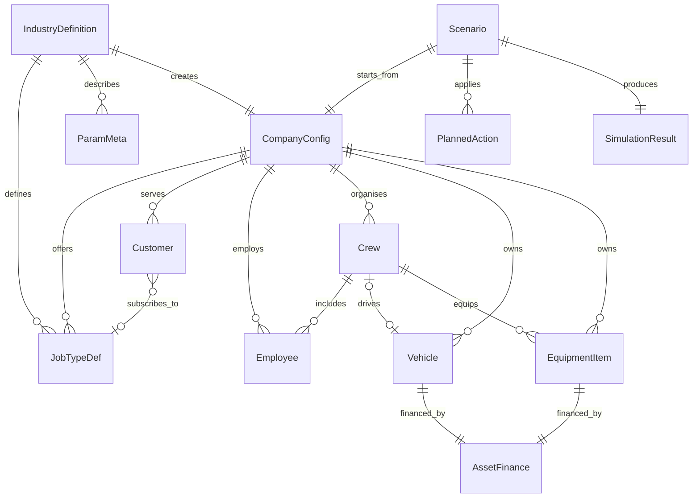

# Data model

This is a readable guide. The source of truth is the type files:
`src/simulation/types.ts` (engine contract) and `src/business/types.ts` (industry
contract). If this guide and a type file disagree, the type file wins and this
guide should be fixed.

## Entities

**Scenario** (`Scenario`): a named plan to simulate. Holds a full `CompanyConfig`,
a list of `PlannedAction`s, a horizon in days and a random seed. Two scenarios
with the same seed share random events, so differences come from the decisions.

**CompanyConfig** (`CompanyConfig`): the complete state of a business at day 0.
It contains the company's job types, employees, crews, vehicles, equipment,
customers and parameter groups: `pricing`, `policies`, `market`, `workforce`,
`reliability`, `weather`, `costs` and `finance`. The `industryId` says which
industry pack it came from.

**JobTypeDef** (`JobTypeDef`): a kind of work. `kind` is `recurring` (repeats on
an interval, `intervalDays`) or `one-off` (arrives at `annualRatePerCustomer`).
It defines labor hours, price, materials, fuel, the equipment types it needs,
minimum skill and crew size, weather sensitivity, splitting, seasonality and
lateness and cancellation thresholds.

**Customer** (`Customer`): a property at a position in miles from the depot. Its
`sizeFactor` scales every job there. `recurringJobTypeId` is its plan, or null.
`phase` staggers its first recurring visit.

**Employee** (`Employee`): a person with an hourly wage, skill level (1 to 3),
productivity, optional crew and tenure in days.

**Crew** (`Crew`): a group that works together, normally with one vehicle.
Employees and equipment belong to a crew.

**Vehicle** (`Vehicle`): a truck with seats, miles per gallon, maintenance cost
per mile and an `AssetFinance` record.

**EquipmentItem** (`EquipmentItem`): a tool such as a mower, with an equipment
type, an optional crew (null means an unassigned spare) and an `AssetFinance`
record.

**AssetFinance** (`AssetFinance`): purchase price, useful life, salvage value,
age, and how the asset is financed. `Financing` is one of `owned`, `loan`
(balance, annual rate, months remaining) or `lease` (monthly payment).

**Action / PlannedAction** (`Action`, `PlannedAction`): a decision, such as
`hire-employee`, `add-crew`, `acquire-vehicle`, `set-price` or
`set-policy`. A `PlannedAction` applies an action on a given simulation day.
Actions are the only way a scenario differs from its base company over time.

**IndustryDefinition** (`IndustryDefinition`): an industry pack. It holds job
types, equipment types, vehicle and equipment catalogs, hire templates, a
standard crew, `ParamMeta` entries and a `createSampleCompany()` factory. The
engine never reads it directly; the factory copies its data into a `CompanyConfig`.

**ParamMeta** (`ParamMeta`): metadata for one editable number. It has the
dot `path` into `CompanyConfig`, a label and description, a unit, bounds, a
step and a provenance class.

**SimulationResult** (`SimulationResult`): engine output for one scenario.
- `days`: a `DailyRecord` for each day (income statement, cash flow, balance
  sheet, operations metrics and end-of-day stocks).
- `months` and `totals`: `PeriodSummary` values with ratios such as utilization
  and net margin.
- `jobTypeStats` and `crewStats`: per-job-type and per-crew figures.
- `events`: breakdowns, quits, hires, cash shortfalls and rejected actions.
- `crewLogs` and `customers`: route and customer detail, present only with
  `detail: 'full'`.
- `warnings`: non-fatal configuration problems.

## Relationships

The diagram is a simplification. For example, `EquipmentItem` links to a crew
through `crewId`, and `JobTypeDef` names equipment types, not equipment items.

## Units

- Money: US dollars as floating-point numbers.
- Time: hours, unless the field name says `Days`, `Months` or `Years`.
- Distance: miles. Speed: miles per hour.
- Rates and shares: fractions (0.1 means 10%).
- Monthly arrays: twelve numbers, index 0 is January.
- Day 0 of a simulation is a Monday and the first day of `startMonth`.

## Provenance of numbers

Every number shown to the user belongs to one of four classes. The interface
must keep them apart.

| Class | Meaning | Example |
|---|---|---|
| `verified-calculation` | Output of the deterministic engine from the inputs | Net profit for a scenario |
| `user-provided` | Entered or edited by the owner | A new truck price the owner types in |
| `industry-assumption` | An illustrative default, not a verified benchmark | Breakdown rates, churn, price elasticity |
| `synthetic-demo` | Fabricated sample-company data | Starting cash, crew names, customer locations |

Default parameter values are illustrative assumptions. They are not benchmarks
or industry averages, and no label may describe them as such.

**All sample-company data is synthetic.** The GreenEdge Lawn & Landscape company,
its employees, customers, vehicles and equipment are fabricated for
demonstration. Its job types, catalogs and default assumptions are illustrative.
The sample company's parameters are recorded in `src/business/landscaping/paramMeta.ts`
with their provenance.
